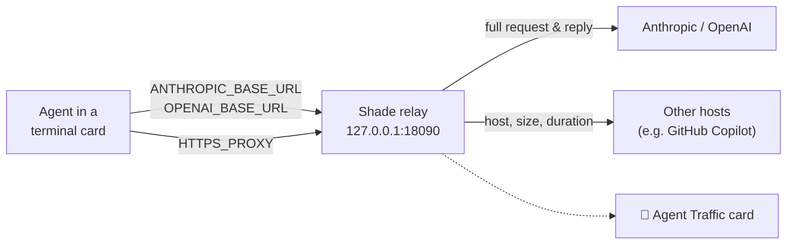

<p align="center"></p>

<h1 align="center">Shade</h1>

<p align="center"><b>Your notes, terminals and code, one keystroke away, on top of every app.</b></p>

<p align="center">
  
  
  
</p>

Press **⌃Space** in any app and a translucent panel drops down from the top of your screen, like a window shade.
Press it again and it's gone. The app you're in (your meeting, your IDE) stays in front the whole time.

<!-- Screenshots: docs/screenshots/*.png, added once captured. -->

## At a glance

| | Feature | What you get |
|---|---|---|
| 📝 | **Notes** | Cards as tabs, color groups, saved as you type |
| 🌐 | **Live translation** | Your notes in another language, side by side, fully on-device |
| 💻 | **Terminal cards** | Your own shell in the panel, with live titles from Claude Code and Copilot CLI |
| 🔔 | **Needs-you alerts** | A macOS notification when a background card waits for input |
| 🛡 | **Sandbox** | Agents can change only the project you pick, and can't read your keys |
| 📡 | **Agent Traffic** | Every model call and connection an agent makes, with prompts and replies |
| 🗂 | **Repo sidebar** | Live git changes, diffs, a file editor, Markdown preview and Quick Open |
| 🔒 | **Private** | Native Swift, no account, no telemetry; nothing leaves your Mac |

## Install

**Download:** grab the latest `.dmg` from [Releases](https://github.com/dineshvg/Shade/releases) and drag Shade to
Applications. Signed and notarized; Apple silicon and Intel, macOS 15+.

**Build from source** (Xcode 26+ / Swift 6.2):

```bash
git clone https://github.com/dineshvg/Shade.git && cd Shade && ./scripts/install.sh
```

Update with `git pull && ./scripts/install.sh`. More in [docs/development.md](docs/development.md).

## Keyboard shortcuts

| Shortcut | Action |
|---|---|
| **⌃Space** | Show or hide the panel from any app (configurable) |
| **Esc** | Hide the panel (goes to the terminal in a terminal card) |
| **⌘T** / **⇧⌘T** | New notes card / new terminal card |
| **🛡** | New sandboxed terminal card |
| **⌘1 … ⌘9** | Switch card |
| **⌘P** | Quick Open a file from the card's repository |
| **⌘B** | Show or hide the repository sidebar |
| **⌘S** | Save a file card |
| 🔴 🟡 🟢 | Hide · roll up to the tabs · fill the screen |

## Features

### 📝 Notes that drop down
- **Cards** as tabs, one per meeting or topic. Double-click a tab to rename it.
- **Groups** like Chrome's tab groups (right-click a card › *Add to New Group*).
- Resize the panel, change the font size and background opacity. Everything is saved as you type.
- By default it floats above every app; turn off ⚙︎ › Panel › *Keep on top of other windows* to let windows cover it.

### 🌐 Live translation
Write in one language, read in another, line by line, as you type. Uses Apple's on-device Translation framework:
free, no account, and the text never leaves your Mac. 12 languages, or auto-detect.

### 💻 Terminal cards
- Your login shell, aliases and tools. Each card keeps running while the panel is hidden.
- The tab shows the title the program sets, so you can follow Claude Code or Copilot CLI at a glance.
- Themed 16-color palettes with **minimum contrast**, so dim hints stay readable in Dark, Light and Paper.
- **🔔 Needs-you alerts** when a card you aren't looking at needs input:

  | Signal | Example |
  |---|---|
  | Program notification (OSC 9 / 777 / 99) | Claude Code with `/config` › Notifications › *iTerm2* |
  | Terminal bell | Any tool that rings the bell |
  | An agent goes quiet for 5 s | Claude Code, Copilot CLI, Codex, Gemini, Aider… |

### 🛡 Sandboxed terminals for agents
Pick a project folder; everything started in that card is confined by macOS's built-in sandbox.

| | Project Only | Strict |
|---|:---:|:---:|
| Write inside the project | ✅ | ✅ |
| Write anywhere else (temp, tool caches and agent state excepted) | ❌ | ❌ |
| Read `~/.ssh`, `~/.aws`, tokens, `.netrc`… | ❌ | ❌ |
| Write git hooks, `PATH` folders, Claude Code's settings | ❌ | ❌ |
| Network | ✅ | Agent services only, via **Record Agent Traffic** |

**Blocked Actions** in the card's bar shows live what the sandbox denied. Details and limits:
[docs/security.md](docs/security.md).

### 📡 See what agents send
Turn on **Record Agent Traffic** (🛡 menu, or the card's bar for a card that's already open), and open the
**Agent Traffic** card:



| View | Shows |
|---|---|
| **List** | Every call: model or host, program, status, tokens or bytes, duration |
| **Summary** | System prompt, last user message, reply, tools offered and used |
| **Request / Response** | The full model call, pretty-printed |

Recordings stay in memory only and are gone when you quit. How it works:
[docs/agent-traffic.md](docs/agent-traffic.md).

### 🗂 See what your agent changed
When a terminal card is inside a git repository, a slim bar shows the branch and the number of changed files.
- **Sidebar (⌘B)** with **Changes** and **Files**; click a file to open it as a card.
- **File cards**: edit and **⌘S**, or view the **diff**. They reload when an agent changes the file, and never
  overwrite your unsaved edits without asking.
- **Syntax highlighting** for ~190 languages and 16 built-in themes, plus **Markdown preview**.
- **Open in your editor**: VS Code, Android Studio, Xcode or your default app.

### 🎨 Make it yours
**Themes** Dark, Light and Paper · **Hide from screen sharing** (best effort) · **Launch at login** ·
**Show in Dock** · a short welcome screen (**?**).

## Privacy

- No account, no analytics, no network calls of its own.
- Notes, settings and recorded traffic stay on your Mac.
- The only things that go online are the 🌐 Google Translate button and *Get More Themes* downloads, and only when
  you click them.

## Documentation

| Doc | For |
|---|---|
| [Security model](docs/security.md) | What the sandbox and Agent Traffic protect against, and what they don't |
| [Agent Traffic](docs/agent-traffic.md) | How recording works, Strict mode, agent hosts |
| [Troubleshooting](docs/troubleshooting.md) | Shortcut conflicts, blocked tools, notifications, build errors |
| [Development](docs/development.md) | Building, code layout, syntax highlighting, releases |

## How Shade was built

Shade was built by me, Dinesh Gangatharan, together with an AI coding assistant. I decided what Shade does and how
it works: the features, the architecture, the security design of the sandbox and of Agent Traffic, and the
name. I tested every build on my Mac and reported what broke; the assistant wrote most of the code. Working that
way is also why the sandbox and Agent Traffic exist: I wanted to see, and limit, what coding agents do on my
machine.

## License

[MIT](LICENSE) © 2026 Dinesh Gangatharan. Third-party components: [THIRD_PARTY_NOTICES.md](THIRD_PARTY_NOTICES.md).

Provided **as is, without warranty of any kind**. "Hide from screen sharing" is best effort, and the sandbox
reduces what a program can reach but is not a guarantee against a determined attacker. Use at your own risk.
