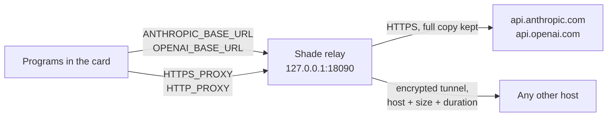

# Agent Traffic

See what programs in a terminal card send over the network.

## Turning it on

- **New card**: turn on **Record Agent Traffic** in the 🛡 menu before opening a terminal card, sandboxed or not.
- **Open card**: click **Record Agent Traffic** in the bar above the terminal, or in the tab's right-click menu.
  Recording starts with the next program you run there; a program that's already running, such as an agent, has to
  be restarted, because a running program's settings can't be changed from outside.

Open the **Agent Traffic** card from the card's bar, or **Agent Traffic** in the menu bar icon.

| View | Shows |
|---|---|
| **List** | Every call with model or host, program, status, tokens or bytes and duration, filterable by card. **Agents** shows calls to model and agent services; **All** shows every connection. |
| **Summary** | For each model call: the system prompt, the last user message, the reply, and the tools offered and used |
| **Request / Response** | The full model call, pretty-printed and highlighted |

## How it works

| Path | What Shade records | Covers |
|---|---|---|
| `ANTHROPIC_BASE_URL`, `OPENAI_BASE_URL` | The full request and reply; replies stream straight through | Claude Code and other tools on the Anthropic API, tools that honor `OPENAI_BASE_URL` |
| `HTTPS_PROXY`, `HTTP_PROXY` | Host, program, bytes each way, duration. HTTPS stays encrypted, so not the contents. | curl, git, npm, pip, Claude Code, GitHub Copilot CLI… |

- Nothing to install, no certificates.
- Shade tells which card and program made a connection by asking macOS which process has it open, like `lsof`.
- Tools that ignore the proxy settings connect directly and aren't recorded; in a Strict card they can't connect at
  all.
- If the relay can't start, the card doesn't start a shell, so nothing runs unrecorded.
- Recordings stay in memory: the last 100 model calls and 1,000 connections, until you click **Clear** or quit
  Shade. Model calls contain your code and prompts.

## Strict + Record Agent Traffic

The auditable setup: the sandbox blocks every connection except to your Mac, so programs can only go out through
Shade, and Shade lets them reach only agent services. Every call is listed, and blocked ones show as **BLOCKED**.

Agent services are Anthropic, Claude, OpenAI, ChatGPT, GitHub Copilot (`githubcopilot.com`, `api.github.com`),
Gemini and Antigravity CLI (`agy`); add your own in ⚙︎ › **Agent Traffic**. There is no official list of every host
an agent uses, so choose **All** in Agent Traffic to see the real ones. In this mode Shade also turns off Claude
Code's non-essential traffic such as telemetry, which would be blocked anyway.
